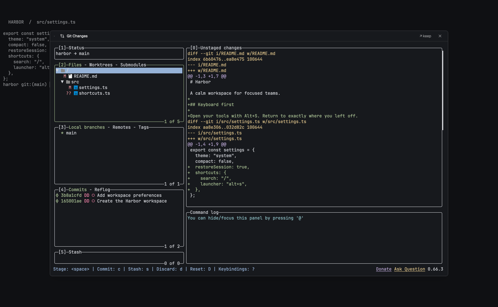
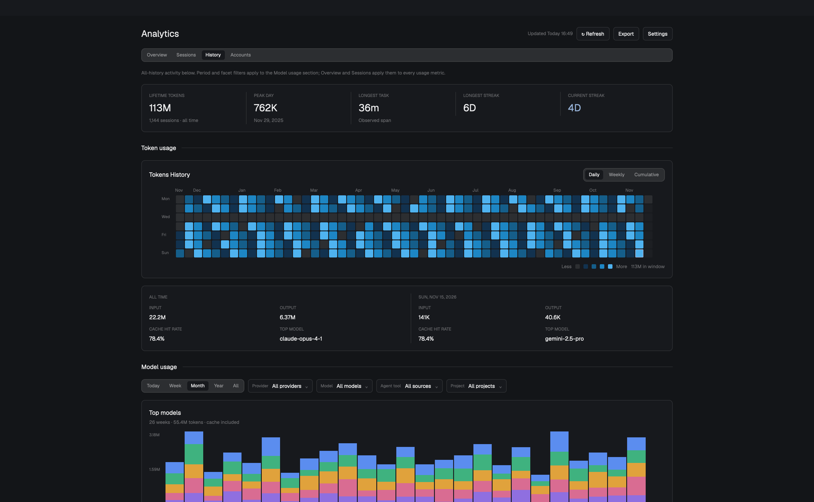

<div align="center">

# Herdr Mods

**Keep your tools close. Keep your agent work in view.**

Two independent, native mods for [Herdr Desktop](https://herdr.dev): floating terminals and a dashboard for agent activity and usage.

[](https://github.com/posquit0/herdr-mods/actions/workflows/checks.yml)
[](LICENSE)
[](https://herdr.dev)

[Floatterm](#floatterm) · [Analytics](#analytics) · [Install](#install) · [Contribute](CONTRIBUTING.md)

</div>

## Pick your mod

| | What it adds | Default shortcut | Requirements |
|---|---|---|---|
| **[Floatterm](floatterm/)** | Shells and terminal tools that float above your work, with sessions scoped to a tab, space, or the whole app | `Alt+S`, then a key; `/` to search | macOS, zsh |
| **[Analytics](analytics/)** | Live agent status, local token history, project/session drilldowns, and optional account quotas | `Cmd+Shift+A` | macOS, Node ≥22.15 |

Install either one. They share no runtime dependency with each other and do not replace your layout. Tested with **Herdr Desktop 0.1.16 on macOS**; this is not a Herdr TUI plugin collection.

## Floatterm

### Your tools, one shortcut away.

Open Lazygit over your code. Keep a scratch shell for each tab. Switch away and return to the floating session you left open.

[](floatterm/)

- **Launch by muscle memory.** `Alt+S`, `g` for Lazygit, or `/` to fuzzy-search your entries.
- **Choose what survives.** Ephemeral and persistent sessions, scoped to a tab, space, or everywhere.
- **Make it yours.** A small JSON file controls names, keys, commands, and working directories.

**[Explore Floatterm →](floatterm/)** · [Configuration and session behavior](floatterm/docs/guide.md)

## Analytics

### See the work. Understand the usage.

Find the agent waiting for you, see which projects use the most tokens, and check your remaining account quota without opening another tab.

[](analytics/)

- **Act on live status.** See working, waiting, and completed agents; jump to their terminals.
- **Follow local usage.** Filter by time, tool, project, provider, and model, then drill into sessions.
- **Check account headroom.** Opt in to Claude, Codex, and Kiro quota lookup with your existing CLI logins.

**[Explore Analytics →](analytics/)** · [Supported sources](analytics/#supported-sources) · [Data and privacy](analytics/docs/guide.md#data-and-privacy)

*Screenshots show the actual native Herdr UI with synthetic demo data, not personal sessions or account readings.*

## Install

### With your coding agent

Give your agent one of these prompts. Each mod ships a [Herdr recipe](https://github.com/herdrdev/herdr-app/blob/master/defaults/AGENTS.md#layouts-and-mods-other-people-made), install instructions, and an optional shortcut snippet.

```text
Install Floatterm from https://github.com/posquit0/herdr-mods/tree/main/floatterm.
Read my Herdr AGENTS.md and review the mod files first. Preserve my layout
and existing key bindings; ask before replacing any shortcut.
```

```text
Install Analytics from https://github.com/posquit0/herdr-mods/tree/main/analytics.
Read my Herdr AGENTS.md and review the mod files first. Preserve my layout
and existing key bindings; ask before replacing any shortcut.
```

### By hand

Clone the repository or download an individual mod from [Releases](https://github.com/posquit0/herdr-mods/releases), then follow **[Floatterm installation](floatterm/#install)** or **[Analytics installation](analytics/#install)**. No npm packages are needed. Installing a mod does not require installing this whole repository into Herdr.

```sh
git clone https://github.com/posquit0/herdr-mods.git
cd herdr-mods
```

Herdr mods run with your access to files and programs. Floatterm executes your configured local commands. Analytics reads local session metadata and runs a Node helper; account-network access is **off by default**. Read each mod's behavior and access notes before installing.

Release notes: [Floatterm](floatterm/CHANGELOG.md) · [Analytics](analytics/CHANGELOG.md). Each mod has its own version and release.

## Feedback and contributions

Found a problem? [Open an issue](https://github.com/posquit0/herdr-mods/issues/new/choose) with the mod name, Herdr version, and steps to reproduce. Do not include tokens, credentials, or raw session transcripts. Ideas, small fixes, and tested configuration examples are welcome; see [CONTRIBUTING.md](CONTRIBUTING.md).

If these mods earn a place in your daily setup, a star helps other Herdr users find them.

## License

Maintained by [@posquit0](https://github.com/posquit0). **Source-available under Apache 2.0 + Commons Clause.** Personal use, internal business use, modification, and free redistribution are permitted under the license. Selling a product or service whose value derives entirely or substantially from these mods requires separate permission. This includes qualifying hosted services and consulting/support. See [LICENSE](LICENSE), [licensing examples](docs/licensing.md), and [third-party notices](analytics/THIRD_PARTY_NOTICES.md).

Independent community mods, not an official Herdr product. Product names and logos identify their respective tools.
