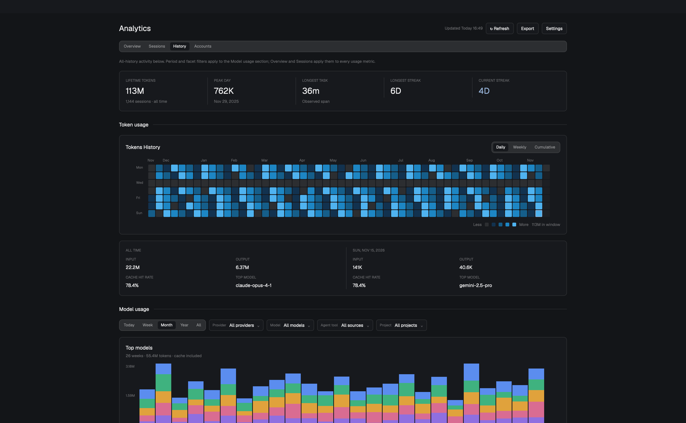
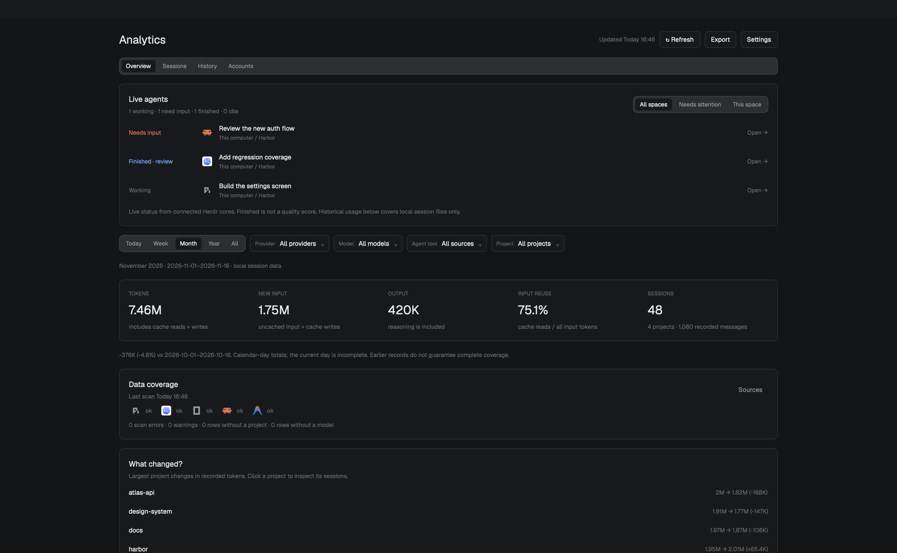
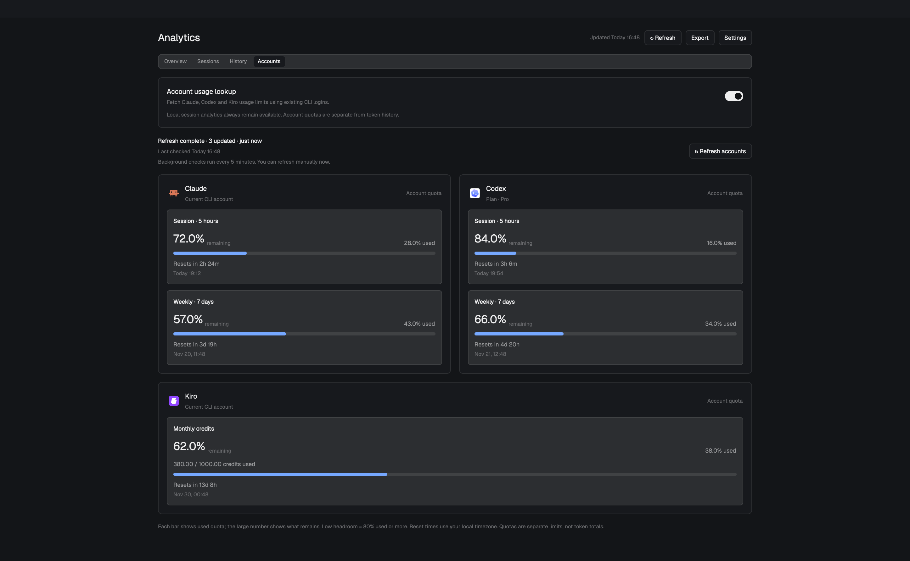

# Analytics

**See the work. Understand the usage.**

A native dashboard for Herdr Desktop: live agent status, local token history, and optional account quotas in one overlay. Keep your working tabs for work.

[](preview.png)

*Actual native UI with synthetic sessions and agent status. Quota screenshots use sample readings.*

[Install](#install) · [Supported sources](#supported-sources) · [Guide and privacy](docs/guide.md) · [Recipe](RECIPE.md) · [All mods](https://github.com/posquit0/herdr-mods)

## From a quick glance to the session behind it

- **Overview:** see who needs attention, jump to an agent, and compare usage across tools and projects.
- **Sessions:** filter by period, tool, project, provider, or model; inspect token components and model usage.
- **History:** explore a contribution-style activity heatmap, lifetime totals, and model rankings.
- **Accounts:** opt in to remaining quota, reset countdowns, and provider-specific limits using existing CLI logins.

Agent icons carry hover labels. Empty history, partial scans, unavailable sources, stale account readings, and rate limits are shown explicitly. Missing data is not presented as zero usage.

<details>
<summary>See live agent status and project-level usage</summary>



</details>

<details>
<summary>See account quotas for Claude, Codex, and Kiro</summary>



These are sample readings, not live account limits. Local token history is kept separate from account quota.

</details>

## Supported sources

| Tool | Local session history | Account quota lookup |
|---|---|---|
| Claude Code | Yes | Yes, existing Claude CLI login |
| Codex | Yes | Yes, existing OAuth CLI login |
| Pi | Yes | — |
| OpenCode | Yes | — |
| Antigravity | Yes | — |
| Kiro CLI | — | Yes, existing Kiro CLI login |

**Local token history and account quota are different measurements.** Local charts cover the session files on this machine. Account cards show server-reported quota windows; they do not provide a complete cross-device token or billing history. API-key-only Codex logins are not supported for quota lookup.

## Install

Requires **Herdr Desktop** and **Node ≥22.15**. Tested with Herdr 0.1.16 on macOS. There are no npm dependencies. Other operating systems have not been validated.

Clone [the repository](https://github.com/posquit0/herdr-mods#by-hand), or download and extract the [Analytics ZIP](https://github.com/posquit0/herdr-mods/releases/download/analytics-v0.1.0/analytics.zip). Run the following from the directory containing `analytics/`: <!-- x-release-please-version -->

```sh
HERDR_HOME="${HERDR_APP_HOME:-${XDG_CONFIG_HOME:-$HOME/.config}/herdr-app}"
if [ -e "$HERDR_HOME/mods/analytics" ]; then
  echo "Already installed: review the update instructions before replacing files."
else
  mkdir -p "$HERDR_HOME/mods" &&
    cp -R analytics/mods/analytics "$HERDR_HOME/mods/" &&
    herdr-app check "$HERDR_HOME/mods/analytics"
fi
```

The copy intentionally does nothing if `analytics` already exists. Review [Updating](#updating-and-removing) for an existing installation; do not overwrite another mod with the same name.

Analytics uses `node` from Herdr's environment by default. If you use mise, nvm, or another version manager, find your supported Node executable with `node -p process.execPath`, then create `$HERDR_HOME/mods/analytics/runtime.json`:

```json
{ "node": "/absolute/path/to/node" }
```

Use the actual absolute path, not `~`, shell syntax, or a URL. [runtime.example.json](runtime.example.json) is a template, not a working path. An incompatible or missing runtime produces an error in the dashboard.

Merge this entry into the `global` object in your Herdr `keys.json`, preserving all existing bindings. Choose another key if it is taken:

```json
{ "global": { "cmd-shift-a": "mod.open:analytics" } }
```

The same snippet is in [keys.json](keys.json). Open without a shortcut:

```sh
herdr-app do mod.open '{"name":"analytics"}'
```

The shortcut toggles the overlay while Herdr is active. Close with `Esc`, the same shortcut, or **×**. No layout file is required. An optional toolbar integration is described in the [guide](docs/guide.md#optional-toolbar-button).

## Private by default, explicit when online

Local history works without account access. **Account usage lookup starts disabled**; enable it on the Accounts page if wanted. It reads existing CLI credentials and sends authenticated requests only to fixed provider endpoints. It does not sign in, refresh tokens, upload transcripts, or change account settings.

Local scanning runs a Node helper and reads configured session files. It stores usage metadata and scan state in Herdr's `data/analytics/`. Reports can contain project paths and session identifiers, so review exports before sharing. See the [complete access and credential reference](docs/guide.md#account-sources).

Account endpoints can change independently of Herdr. Missing credentials, expired logins, and provider failures appear per card. Refresh accounts shows progress, deduplicates in-flight requests, and respects server retry delays.

## Updating and removing

Before updating, back up the installed mod and your `keys.json`. Preserve a custom `runtime.json`. Review changes, replace the bundled code and license, and run `herdr-app check` plus a real dashboard check. Preferences and indexed data live outside the mod folder.

To remove Analytics, close the overlay, remove its shortcut and any optional toolbar reference, then remove the installed mod folder. You may separately remove `data/analytics/` to discard its local index. Removing Analytics does not remove your original agent sessions or CLI logins. Account preferences may remain in Herdr's shared state; do not delete the entire `shared.json`.

## Development

Run `npm test` from the repository root. Tests use synthetic sessions and credentials; they never require a real provider login. [Contributions welcome →](https://github.com/posquit0/herdr-mods/blob/main/CONTRIBUTING.md)

Source-available under [Apache 2.0 + Commons Clause](LICENSE): internal business use and free redistribution are allowed; selling the mod or a service whose value derives substantially from it requires separate permission. Preserve the [third-party notices](THIRD_PARTY_NOTICES.md).
