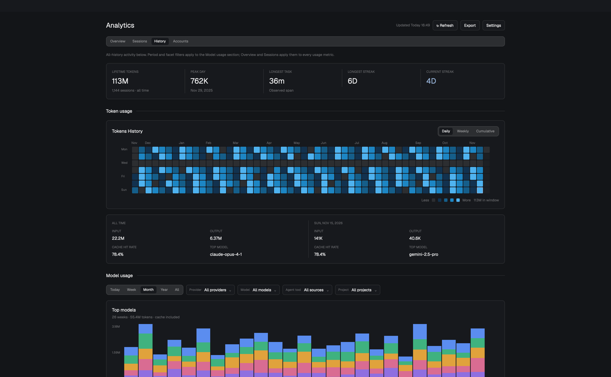

# Analytics

A native Herdr dashboard for understanding coding-agent activity and usage. It opens as a large overlay without taking a working tab. Local session history remains useful without network access; optional account cards show quota windows from existing CLI logins.

## What you see

The overlay fills 90% of the window width and 85% of its height. A vertically scrolling, centered content column is at most 1180px wide. Use the active Herdr theme, 1px borders, 8px card corners, 6px control corners, and 4/8/12/16/24px spacing. Page padding is 12px below 620px, 16px below 900px, and 24px otherwise. Typography: 20px page title, 13.5px card title, 22px main metrics, 11.5px body, and 9.5–10.5px supporting text.

The header contains the name, refresh status, Refresh, Export, Settings, and the overlay close button. Below it are Overview, Sessions, History, and Accounts tabs.

Overview begins with live agents ordered by attention needed, followed by period/facet filters, token components, tool/project usage, project changes, and data coverage. Sessions uses the same filters and shows the largest matching sessions; selecting one shows token and model details. Known agent types use Herdr icons with full names on hover and accessibility labels; unknown types use initials.

History shows lifetime metrics, a 53-week activity heatmap, selected-day detail, weekly model bars, and model rankings. Each detail column uses two rows of two metrics so long model names have room; narrow views wrap the columns. Heatmap cells are 12–20px; narrow views keep the newest weeks. Accounts begins with the account-lookup setting and then one card per provider. Large percentages mean quota remaining; bars mean quota used. Reset countdowns include exact local times. Monthly Kiro plan credits and overage appear separately when reported.

## How it behaves

Cmd+Shift+A toggles the overlay; Escape or × closes it. No tab is created. Overview, Sessions, and their exports follow the chosen period and facets (tool, project, provider, model). Clicking a tool/project opens its sessions; clicking a live agent closes the overlay and focuses the terminal. Live statuses distinguish working, needs input, finished awaiting review, idle, and unknown. Finished is not a success score.

History's lifetime statistics and heatmap remain global; its filters apply to Model usage. Hover describes chart values and agent types. Settings edits source roots, enabled sources, refresh interval, week start, palette, and cache accounting. Export saves a Markdown report chosen by the user.

Account lookup starts disabled and preserves an existing preference. Enabling it reads already-authenticated Claude, Codex, and Kiro CLI accounts. Refresh accounts checks immediately, shows elapsed progress and completion/failure counts, and deduplicates concurrent work. Automatic checks run at most every five minutes. Server retry delays block both automatic and manual requests, with a live countdown. Disabling lookup invalidates late results and stops new credential reads/requests.

Unknown values stay unavailable. Partial scans, missing metadata, unavailable machines, errors, and insufficient comparison history stay visible. Quota at 80% used is low headroom; 100% is limit reached. Data older than ten minutes is marked last known. A past reset time requests a fresh reading, not an assumed recovery.

## Built from

`mods/analytics/main.js` renders native `gpui-kit`/`gpui-base` views. `ui.js` supplies theme-aware controls and agent icons; `analytics.js` aggregates and formats; `fleet.js` normalizes live agents; `account-state.js` coordinates shared requests; `account-presentation.js` formats quotas. `mod.json` defines the overlay and `keys.json` is an optional binding snippet. Toolbar mode (`props.mode = "toolbar"`) only draws an entry button.

Herdr APIs include `agents`, `terminals`, `spaces`, `machines`, `shared`, `setShared`, `exec`, `readTextFile`, `writeTextFile`, `pickFolder`, `nextCommand`, `run`, `closeOverlay`, `props`, `theme`, and `settings`. Live metadata includes connected cores but is never guessed into a join with historical session IDs.

External Node ≥22.15 runs the collector/indexer/presenter and optional account helper. There are no npm dependencies. The runtime defaults to `node`; optional `runtime.json` names an executable. `core/` reads Pi, Codex, Claude Code, OpenCode, and Antigravity local history, including SQLite and compressed inputs. Cache/index state is under Herdr's `data/analytics/`.

Account helpers read existing credentials and query fixed Claude, ChatGPT/Codex, and supported Kiro AWS endpoints. On macOS, default Claude credentials can fall back to the exact CLI Keychain item. See the guide's account-source table for paths and endpoints. Credentials never become UI state or command-line arguments; redirects are rejected. No token refresh, login, or chat fallback runs.

Preserve all bundled license notices, including those for third-party code and assets. Agent icons reference Herdr's installed icons. No layout is bundled and Floatterm is not required.

## Watch out

Tested with Herdr Desktop 0.1.16 on macOS. Node APIs run in subprocesses, never inside Herdr's native JS runtime. A runtime error must explain how to fix the Node path. The local store includes project paths and session identifiers; it is not anonymized data. Do not publish it, credentials, transcripts, or unreviewed exports.

Local history is not all-device history. Quotas are not token totals or subscription spend and must not be summed across windows/providers. Kiro account support does not imply Kiro local-history collection. Account endpoints are not stable public billing APIs and can change. Ambiguous Kiro bonus/plan spending must be reported unavailable instead of inventing a percentage.

Keep totals complete while limiting details: 50 sessions, 10 projects, 8 selected-session models; live agent rows start at 5 and expand to at most 50. An initial native check cannot validate loaded data, deferred views, or later async errors. Preserve other mods, layouts, and shortcut bindings during installation.

## Done when

- Native checks and fixture tests pass, and the loaded Overview, Sessions, History, Accounts, and Settings views render in Herdr.
- The shortcut opens/closes one overlay without creating a tab; agent navigation reaches the selected terminal.
- Project/tool → session → model drilldowns and exports honor the selected filters, while History labels its global metrics clearly.
- Empty sources, partial history, unavailable metadata, and failed scans do not masquerade as complete zero usage.
- With account lookup disabled, no account credentials, Keychain, or provider endpoints are touched.
- Synthetic provider results exercise valid quotas, genuine zero, unknown limits, expiry, rate limits, Kiro credits, stale readings, and redaction.
- Refresh visibly enters progress, blocks duplicates, reports each provider, and honors retry countdowns; disabling lookup discards late responses.
- Light/dark themes and narrow widths remain readable; icons expose full names on hover.
- Distribution has a real preview, license/provenance, no personal runtime paths or state, and no layouts folder.
