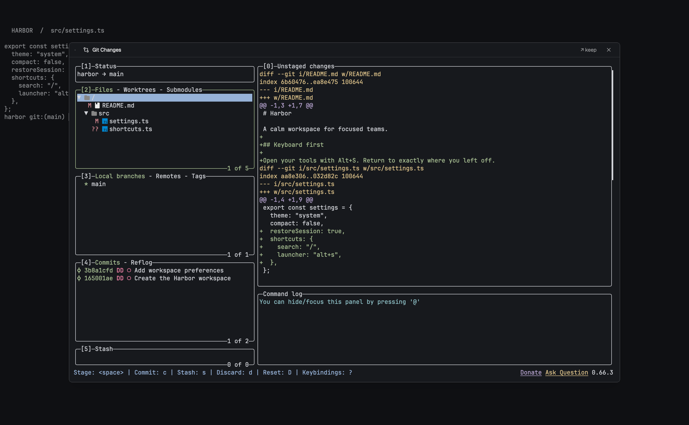
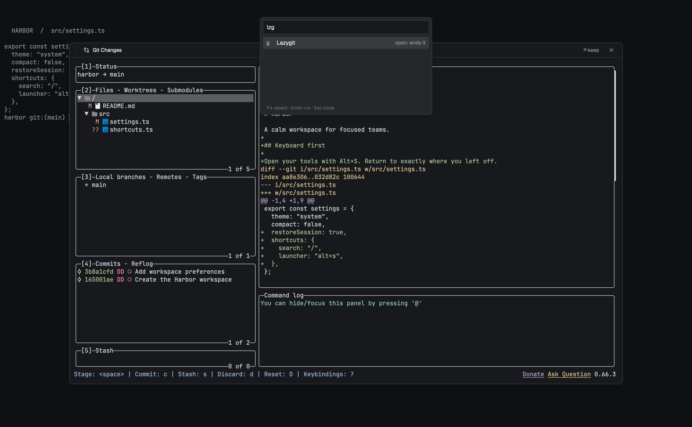

# Floatterm

**Your tools, one shortcut away.**

A native floating-terminal launcher for Herdr Desktop. Pop open a shell, Lazygit, or another terminal tool over your current work; keep sessions attached to a tab, a space, or the whole app.

[](preview.png)

*Actual Herdr UI in a demo workspace. No personal repository data is shown.*

[Install](#install) · [Configure](#configure) · [Session behavior](docs/guide.md#sessions) · [Recipe](RECIPE.md) · [All mods](https://github.com/posquit0/herdr-mods)

## A small menu for your daily tools

- **Two-keystroke launch:** `Alt+S`, then `g` opens Lazygit.
- **Search when you need it:** `Alt+S`, `/`, `lzg`, `Enter` fuzzy-matches Lazygit. Direct shortcuts still work before search begins.
- **Work where you are:** new sessions use the focused terminal's directory unless you set another one.
- **Keep context:** switching away hides a tab-scoped popup; returning restores it. Explicitly dismissed popups stay hidden.
- **Choose the lifetime:** persistent sessions are reused; ephemeral sessions can be ended with their shortcut from inside the popup.

<details>
<summary>See fuzzy search over a running terminal</summary>



`/` enters search mode. The menu keeps the running terminal visible underneath; selecting an already-open ephemeral entry from inside its popup ends that session.

</details>

## Install

Requires **Herdr Desktop** and **macOS with `/bin/zsh`**. Tested with Herdr 0.1.16. Install Lazygit separately if you want the bundled Git entry; the shell entries need no extra tools. Floatterm itself does not require Node.

Clone [the repository](https://github.com/posquit0/herdr-mods#by-hand), or download and extract the [Floatterm ZIP](https://github.com/posquit0/herdr-mods/releases/download/floatterm-v0.1.0/floatterm.zip). Run the following from the directory containing `floatterm/`: <!-- x-release-please-version -->

```sh
HERDR_HOME="${HERDR_APP_HOME:-${XDG_CONFIG_HOME:-$HOME/.config}/herdr-app}"
if [ -e "$HERDR_HOME/mods/floatterm" ]; then
  echo "Already installed: review the update instructions before replacing files."
else
  mkdir -p "$HERDR_HOME/mods" &&
    cp -R floatterm/mods/floatterm "$HERDR_HOME/mods/" &&
    herdr-app check "$HERDR_HOME/mods/floatterm"
fi
```

The copy intentionally does nothing if `floatterm` already exists. For an existing installation, follow [Updating](#updating-and-removing) instead. Do not overwrite another mod with the same name.

Merge this entry into the `global` object in your Herdr `keys.json`, preserving every other binding. If `alt-s` is taken, choose another key. On macOS, Option-letter combinations can also produce characters on some keyboard layouts.

```json
{ "global": { "alt-s": "mod.open:floatterm" } }
```

The same snippet is available as [keys.json](keys.json). To try the menu without a shortcut:

```sh
herdr-app do mod.open '{"name":"floatterm"}'
```

Shortcuts work while **Herdr is active**; they are not system-wide macOS hotkeys. No layout file is required.

## Configure

Edit `$HERDR_HOME/mods/floatterm/config.json`. The menu rereads it each time it opens. This complete example gives you a scratch shell, a disposable shell, and Lazygit:

```json
[
  { "id": "scratch", "name": "Scratch shell", "key": "s", "session": "persistent", "scope": "tab" },
  { "id": "shell", "name": "Fresh shell", "key": "f", "session": "ephemeral", "scope": "tab" },
  { "id": "lazygit", "name": "Lazygit", "key": "g", "command": "lazygit", "scope": "tab" }
]
```

Add as many entries as you need. Set `command` to a shell command, `cwd` to a starting directory, and `scope` to `tab`, `space`, or `global`. Keep `id` stable to reuse a running session. `/` is reserved for search.

See the **[full configuration reference and session rules](docs/guide.md)** before customizing lifetime behavior. Closing the popup hides it; it does not automatically kill an ephemeral session. Exiting the shell ends the session in either mode. Persistent recovery after a reboot creates a new shell, not the old program's in-memory state.

## Access and limits

Floatterm runs configured commands **locally**, through zsh and `herdr-core`. Shell startup files and those commands have your normal user permissions and may access files or networks. Floatterm makes no direct HTTP requests. In a remote space, its default directory falls back to your local home.

Changing the Herdr layout closes Floatterm's restoration controller. Open the menu once to recreate it; running terminals remain alive. A deleted owner tab or space is not recreated, and its floating sessions are not automatically terminated. End sessions you no longer need before deleting their owners.

## Updating and removing

Before updating, back up the installed folder and your `keys.json`. Preserve your customized `config.json`; compare the new defaults rather than replacing it. Review changes, replace the mod's code and license, then run `herdr-app check` again and exercise your shortcuts.

To remove Floatterm, first exit its running shells/tools, remove its shortcut entry, then remove its installed mod folder. Removing the files alone does not kill core terminal sessions. No layout restoration is needed.

## Development

From the repository root, run `npm test` with Node ≥22.15 to test command routing, fuzzy search, session scopes, focus races, and popup restoration. See [CONTRIBUTING.md](https://github.com/posquit0/herdr-mods/blob/main/CONTRIBUTING.md). Source-available under [Apache 2.0 + Commons Clause](LICENSE): internal business use and free redistribution are allowed; selling the mod or a service whose value derives substantially from it requires separate permission.
