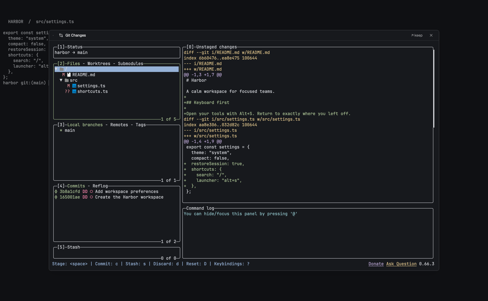

# Floatterm

A floating-terminal launcher for Herdr Desktop. A compact shortcut menu opens shells or terminal tools above the current work. Sessions can belong to a tab, a space, or the entire app, and navigation-hidden popups return with their owner.

## What you see

The menu is a top popup, offset 40px, 400px wide and 240px high. It has 6px padding and gaps, 13px text, and a 150px scrollable results area. Each 28px row shows an accent-colored shortcut, a name, and session metadata. The selected row uses the theme's selection color; hover uses its hover color. The footer uses 11px dim text. Search adds a 32px native input with a 1px border and 4px corners.

A launched terminal appears in a centered dialog taking 80% of the window's width and height. Its 34px header uses Herdr's normal terminal peek controls. Colors follow the active Herdr theme. There are no invented agent status badges; terminal content is the actual running program.

## How it behaves

Alt+S toggles the menu. Before search starts, an entry's key launches it immediately. `/` starts fuzzy search across names, IDs, commands, and key aliases. All query words must match; exact and contiguous matches rank ahead of scattered letters. Arrow keys wrap through results, Enter launches, and Escape closes. Native input provides paste, editing, and IME support. Opening the menu resets its search.

New sessions start in the directory captured when the menu opens, unless the entry specifies a directory. A remote space or unavailable directory falls back to local home. Shells and commands execute locally.

Each entry has one running session per configured scope. Persistent entries reuse it and hide when selected from inside their own popup. Ephemeral entries also reuse a hidden session, but selecting one from inside its popup ends it. Clicking behind a popup or closing its header only hides it. Exiting the program ends either session type.

Leaving the owning scope hides a popup; returning restores it and its keyboard focus. A popup explicitly dismissed by the user does not automatically return. Restoration waits while the launcher menu is open. Opening a different tab produces a separate tab-scoped session; space scope shares within a space; global scope shares everywhere. Renaming owners does not break identity.

## Built from

`mods/floatterm/main.js` uses native `gpui-kit` and `gpui-base` elements, `InputState`, and `ScrollHandle`. `mod.json` defines the launcher overlay. `keys.json` supplies the optional global `mod.open:floatterm` binding. `config.json` is a reread-on-open array of entries: required unique `id` and `key`, optional `name`, `command`, `cwd`, `session` (ephemeral by default), and `scope` (tab by default).

Herdr APIs include `hc`, `focused`, `spaces`, `terminals`, `home`, `appHome`, `readTextFile`, `openOverlay`, `closeOverlay`, `run`, and `notify`. Shells use `/bin/zsh -l`; commands use `/bin/zsh -lic`. A persistent entry adds the core's keep flag. Terminal labels carry entry identity and scope.

The terminal dialog's layout has a zero-height scope guard, the shipped `peek` mod, and a terminal block. A shared invisible zero-size controller window watches navigation and restores suspended popups without polling. It is created once when the menu opens and recreated after a layout change. No layout file or third-party assets are shipped.

## Watch out

This is tested on macOS, Herdr Desktop 0.1.16. It depends on zsh and Herdr's core/peek APIs. Shortcuts are app-local, not global macOS hotkeys. `/` is reserved; choose another alias for an entry. Alt/Option shortcuts can replace typed characters on some keyboard layouts.

Commands and shell startup files run with the user's permissions. A bad configuration must show an error and launch nothing. Never overwrite existing mod names or shortcuts when installing. If renaming this mod, rewrite its internal mod paths and self references too.

Scope changes do not migrate or terminate old sessions. Deleted owner tabs/spaces are not recreated. Closing an owner does not kill its floating sessions. A layout change destroys the controller until the next menu opening; a mod reload or app restart loses in-memory popup visibility. Persistent core recovery starts a new shell, not the previous program with its original memory. A slow launch completing after navigation must not appear over an unrelated tab.

## Done when

- The native mod check passes, and opening the menu in the app shows all configured entries.
- Alt+S then g opens installed Lazygit in the original working directory; slash then `lzg` finds it.
- Empty results, pasted input, arrow wrapping, and invalid JSON behave without launching the wrong entry.
- Reopening a hidden ephemeral popup works; selecting it from within ends it. A persistent entry retains its running shell.
- Tab and space scopes isolate sessions correctly; navigation-hidden popups restore only for their owner, while manually dismissed ones stay hidden.
- Navigating during startup does not show the terminal in the wrong tab or leave a loading error.
- Repeated menu opening reuses one controller; after switching layouts, opening the menu restores automatic navigation handling.
- The package has no layout, no personal state, and no required dependency on Analytics.
